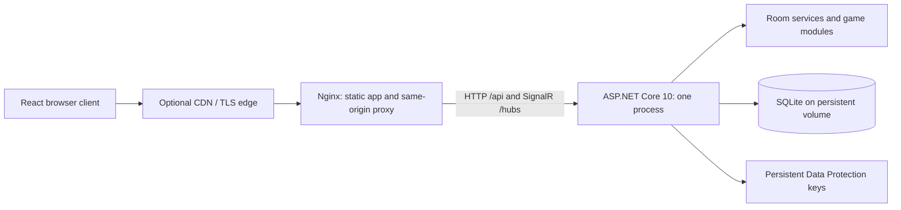

# Proposed architecture

Status: foundation and M1 room lifecycle implemented by 2026-10-24. The catalogue,
guest identity, create/join/lobby, facilitator controls, authorized SignalR
subscriptions, durable command receipts, expiry, and reconnect recovery exist.
Game sessions, rounds, prompts, and administration below describe future milestones.
M0 and M1 have passing hosted CI evidence linked in the implementation plan.

## Components and decisions



| Area | Proposed choice | Reason and boundary |
| --- | --- | --- |
| Browser | React, TypeScript strict mode, Vite, React Router | Interactive SPA backed by a separate API; server rendering is unnecessary for private game rooms |
| UI state | Small room snapshot store plus local form state | One authoritative server view; avoid duplicating game rules in frontend stores |
| Styling | CSS variables and scoped styles; accessible primitives as needed | Establish a distinctive visual system without requiring a large component framework |
| API | ASP.NET Core 10 feature-oriented HTTP endpoints and SignalR | One service owns validation, identity, commands, and live notifications |
| Storage | EF Core 10 with SQLite | Simple durable single-host operation; reassess with measured write contention |
| Deployment | Nginx and one API process in Docker Compose | Same-origin authentication and a small operational footprint |
| Verification | xUnit, API integration tests, Vitest/Testing Library, Playwright | Cover pure rules, real persistence/authentication, UI behavior, and multiple browsers |

A Vite SPA is an intentional choice for these requirements. React documents this
route while noting that routing and data-fetching conventions must be supplied by
the application. [React documentation](https://react.dev/learn/build-a-react-app-from-scratch)

## Repository layout and planned extensions

```text
TeamGames.slnx
server/
  TeamGames.Api/               # HTTP endpoints, guest authentication, room hub
  TeamGames.Core/              # Catalogue, room rules and public DTOs; games planned
  TeamGames.Infrastructure/    # EF Core, migrations, persistence implementations
web/
  src/
    app/                      # Routing and application shell
    features/rooms/           # Entry forms and live lobby; other features planned
    games/                    # Planned: registry and game-specific views
    realtime/                 # Connection lifecycle and snapshot reconciliation
    api/                      # Typed API client and transport contracts
    ui/                       # Shared accessible components and design tokens
  e2e/                        # Playwright catalogue and independent room browsers
tests/
  TeamGames.Core.Tests/
  TeamGames.Api.Tests/
infra/                        # Proxy and container configuration
tools/TeamGames.Contracts/     # Generates/checks TypeScript from public room DTOs
docs/
compose.yaml
```

Core has no dependency on ASP.NET, SignalR, or EF Core. API and Infrastructure
depend on Core. Use focused interfaces for persistence, clock, random selection,
and notifications; avoid generic repository frameworks or a separate microservice
for each game. Organize frontend features together rather than by component type.

## Domain and game extension boundary

Persist rooms, guest identities, memberships/roles, game sessions, rounds, answers,
prompts, processed commands, and administrative audit events. A room has one active
game session. Each round retains its prompt text, eligible roster, stage revision,
submissions, and finalized result. Persist module state with an explicit schema
version and migration strategy; do not deserialize arbitrary runtime type names.

Room lifecycle: `Lobby -> Playing -> Lobby -> Closed`, with closure allowed from
any live state. Simple rounds: `Responding -> Revealed -> Completed` (or skipped).
Two Truths and a Lie adds a collection stage before its presenter rounds.

Each game module supplies metadata, settings/input validation, initial state,
allowed actions, deterministic transitions, result calculation, and per-viewer
projection. The room service handles identity, command serialization, persistence,
expiry, and delivery. The React registry maps stable game IDs to views for each
stage. Binary-choice mechanics can be shared by This or That and Would You Rather?
while keeping content and rendering separate. New modules are registered in code.

Each module receives the actor, eligible roster, current state, and injected time
or random values. It returns a new state or a domain error. It must handle forced
advance, zero answers, passes, removed players, and invalid/stale commands.

M2 implements `IGameModule` / `GameModules` with deterministic injected random
selection and the This or That module. `Rooms.GameState` is a version 3 JSON
envelope of sessions; each module owns its state representation. Completed rounds
retain prompt text, roster and submissions separately from their immutable public
results. Version 1 aggregate-only results are read with empty named-choice lists;
new revealed rounds snapshot each eligible player’s choice, and projection replaces
removed participants’ names with a neutral label. The envelope accepts versions 1 and 2 and advances to version 3 on the next
accepted mutation, adding stable prompt usage and saved filters. Keep old state readable with an explicit migration
when its schema or prompt identifiers change. Room deletion cascades by deleting this
owned state with the room. No runtime type names are deserialized.

The additive `game` DTO contains only the current viewer's answer/revision,
aggregate response counts, server-authorized actions, and finalized result DTOs.
The command includes session/round IDs, stage revision and own response revision.
Answers do not compare the shared room version. Start compares the lobby version;
all accepted commands still increment the room version for snapshot ordering.

M3 adds a typed `Prompts` table with stable IDs, game/category/tag metadata,
text/options, source, enabled status, ownership, revision, and seed fingerprint.
Room prompt foreign keys cascade on room deletion. Normalized duplicate indexes
separate the shared library and each room; validation also rejects room duplicates
of shared prompts. Browsing and room authoring require the current facilitator.

Enabled global and room prompts are supplied as domain input to game modules.
This or That selects from category/tag/search filters, stores selected text/options
in the round, and persists used stable IDs. Its old twelve-index usage migrates
on read without changing active or historical text. Reset removes usage only for
the exhausted filtered pool. Rounds retain their numbering across resets.

Prompt commands share the room command receipt and transaction boundary. Library
edits increment the room version and prompt revision, then publish safe snapshots.
Seed updates apply only to untouched shared rows, preserve edits/disabling, and
skip conflicting content. Administrator UI and other gameplay modules remain
later milestones.

## Identity and authorization

- Create a cryptographically random guest session on first create/join. Store its
  verifier server-side and place the credential in an HttpOnly, Secure,
  SameSite=Lax cookie in production. Local HTTP requires an explicit override;
  Development and the loopback-only Compose profile enable that override.
  One guest can hold memberships in multiple rooms; use one membership per room.
- Creating a room assigns its creator the facilitator role. All endpoints resolve
  the actor from the cookie and current membership, never a supplied player ID.
  Room links/codes are invitations to join, not proof of membership or privilege.
- Use random non-sequential room codes, collision checks, bounded room capacity,
  and rate limits on creation, lookup, joining, and authentication. A room lock
  blocks new joins but permits existing members to reconnect.
- Require antiforgery tokens for cookie-authenticated mutations, including admin
  login. Validate allowed origins for hub negotiation/transports and WebSocket
  upgrades; same-origin deployment is the default. Escape all player/prompt text.
- Authenticate the hub and authorize room subscriptions on every connection.
  Recheck current membership before delivering a private view. Removal/closure
  revokes access, including existing connections. Closure delivers a final view,
  ends live subscriptions, and blocks new subscriptions/joins/mutations. Existing
  members may read the terminal closed view or retry their own acknowledged
  command until retention cleanup; this makes reload/lost-ack recovery explicit.
- Keep an administrator credential in environment/secret configuration, fail
  closed when absent, and exchange it for a short-lived separate admin cookie.
  Use framework credential protection and rate limiting; never embed the secret
  in frontend code, query strings, or a checked-in default.
- Persist Data Protection keys with restricted permissions so protected cookies
  survive API restarts. Logs exclude credentials, raw answers, and private state.

Without accounts, clearing cookies loses identity. Before leaving, a facilitator
can transfer ownership; an administrator can recover an abandoned room. This
limitation should be explained in the UI, without adding account registration.

## HTTP and realtime contract

Use HTTP for all gameplay mutations and snapshot retrieval. Use `/hubs/rooms` for
authorized subscriptions and server-to-client snapshot notifications. This keeps
commands independently retryable when sockets are interrupted.

Planned endpoint groups are `/api/rooms` (create/join/read), room membership and
facilitator actions, game sessions/round responses, prompt browsing/management,
and `/api/admin` (authentication and operations). Publish an OpenAPI contract and
generate/check TypeScript HTTP types. M1 generates shared HTTP/hub DTO interfaces
directly from the public Core records and checks them in CI. Runtime validation
checks protocol version 1. `Snapshot` carries the view; `AccessEnded` carries an
error code and is followed by disconnect. OpenAPI alone does not cover hub events.

Every mutation carries a unique command ID. Round commands also carry a round ID
and stage revision. M1 uses one asynchronous writer gate for short SQLite
transactions across all rooms (including guest creation and maintenance). No
notification is sent under it. This avoids cross-room SQLite write contention on
the single API process; revisit after the M6 capacity measurements. The server:

1. Authenticates the actor and checks current room access.
2. Looks up the command receipt scoped to actor and room. A matching retry returns
   its applied version alongside a current authorized snapshot; a reused ID with
   a different payload is rejected. M1 IDs are unique per guest across rooms, so
   create requests can also be deduplicated before a room ID is known.
3. Checks the action, round, stage, eligibility, and input limits.
4. Applies the transition and commits state, an increasing room version, and the
   receipt in one database transaction.
5. Acknowledges the command and publishes fresh, authorized snapshots after commit.

Use separate stage revisions and room versions: another player's answer must not
make a valid answer stale. Facilitator advance actions require the expected stage
revision, preventing double advances. A response update carries its own revision
to detect conflicting edits from multiple tabs. Database constraints enforce
unique command IDs and one current response per participant/round.

Return typed errors (for example `stage_changed`, `room_closed`, or
`membership_revoked`) with appropriate HTTP status codes. On conflict, resync and
explain the current state. Do not silently submit an old answer into a new round.
Checking authorization precedes returning old command receipts, so a removed
participant cannot use retries to recover private state.

Snapshots include a protocol version, room ID/version, stage revision, public
roster, current game/stage, allowed actions, answer counts, and the viewer's own
answer state. Reveal results are added only when allowed. Project every snapshot
server-side for its audience; never broadcast the persisted game object to a room.
Responses and counts must not identify other players' unrevealed selections.

## Reconnect, ordering, and delivery gaps

Register handlers before starting SignalR. After connecting, authorize/subscribe
first, then fetch a full snapshot. Accept only newer room versions from either
path, so a slower HTTP response cannot overwrite a newer event. Repeat this
process after reconnect, tab wake, or transport fallback. Use a separate transient
presence revision and process epoch so connection changes need not write gameplay
transactions. Subscribe plus HTTP resync accepts a new epoch after restart;
ordinary old events cannot replace it.

SignalR automatic reconnect is opt-in, and initial start failures need their own
retry loop. Configure both with exponential backoff, jitter, and cancellation;
show recovery status and a manual retry after a bounded recovery window. Restore
the current participant through their cookie, never the connection ID.
[SignalR JavaScript client](https://learn.microsoft.com/en-us/aspnet/core/signalr/javascript-client?view=aspnetcore-10.0)

Persist before delivery, and periodically reconcile active clients with a
lightweight room-version check (proposed 15 seconds, staggered). This covers the
commit-then-crash/send-failure gap without an event log or durable delivery queue.
Reconnect always reloads current state; replay of every intermediate event is not
required. Accepted commands can be retried with the same ID after a lost response.

Use WebSockets when available, with SignalR negotiation and Long Polling available
as a fallback. Test a fresh connection using fallback explicitly; do not assume a
dropped WebSocket automatically switches transport. Set polling duration below
edge request limits. Keepalive settings help idle connections but cannot overcome
a CDN's absolute connection lifetime limit. Full resync remains mandatory.

SignalR also provides optional buffered stateful reconnect, but it is an
optimization, not the persistence or recovery design. Defer enabling it until the
base recovery tests pass. Coordinate server/client timeouts and proxy settings.
[SignalR configuration](https://learn.microsoft.com/en-us/aspnet/core/signalr/configuration?view=aspnetcore-10.0)

Count presence by participant across all live connections, with a short grace
period for transport churn. A stale disconnect callback must not mark a newly
reconnected participant offline. Presence never changes facilitator rights or
blocks stage progression. Disable submissions while unsynchronized, retaining
local drafts until they can be reconciled against the current stage.

## Persistence and operations

SQLite is the durable source of truth. Keep transactions short, enable WAL mode,
set a bounded busy timeout, and serialize writes through the single-process gate. Use an
application-managed concurrency field: the EF SQLite provider does not support
database-generated concurrency tokens. Test migrations against real SQLite.
[EF Core SQLite limitations](https://learn.microsoft.com/en-us/ef/core/providers/sqlite/limitations)

Keep gameplay and command receipts in the same database transaction; retain
receipts until room deletion. A memory cache is optional and must be invalidated
after commit. Persist UTC timestamps and run an idempotent expiry sweep at startup
and periodically. Reset transient presence after restart; participants reattach
to their persisted memberships and rounds.

Compose builds the frontend in a Node build stage and serves the output from
Nginx, which proxies `/api/*` and `/hubs/*` to a multi-stage .NET API image. Only the
proxy publishes a host port. Use the persistent `app-data` volume for the database
and its `keys/` subdirectory, so backups retain the database and protected key ring
together. Run as non-root where supported; include readiness/liveness endpoints and
graceful shutdown. Readiness requires migrations and storage initialization.

Compose startup ordering is insufficient to establish readiness; gate dependencies
with health checks. [Docker Compose startup guidance](https://docs.docker.com/compose/how-tos/startup-order/)

Keep hashed assets cacheable and HTML revalidated. Bypass CDN caching for `/api/*`
and `/hubs/*`, including negotiation, snapshots, and errors. Preserve cookies and
WebSocket upgrade headers; disable realtime buffering. Terminate TLS at a
documented edge/proxy and trust forwarded headers only from configured proxies.
Provide both local HTTP and production HTTPS deployment examples.

The launch deployment has exactly one API process. SignalR documents additional
affinity requirements for most multi-server configurations; horizontal scale also
requires shared state, identity keys, and coordination beyond this design.
[SignalR hosting guidance](https://learn.microsoft.com/en-us/aspnet/core/signalr/scale?view=aspnetcore-10.0)

Document migrations, upgrades, rollback compatibility, and consistent SQLite
backups/restores (including the protected key volume). Do not copy a live SQLite
database file without accounting for WAL. Capture structured errors and metrics
for active rooms, command latency/conflicts, reconnects, and storage failures.

## Risks to resolve through implementation

| Risk | Proof required |
| --- | --- |
| Private state reaches a wrong audience | Inspect HTTP/hub payloads at every stage for players, facilitator, admin, and another room |
| Retry or simultaneous requests change a result twice | Race submit/advance, replay command IDs, and restart after commit |
| Proxy churn breaks identity or progress | Repeatedly terminate sockets; test offline, page reload, and Long Polling |
| SQLite writes bottleneck | Benchmark 20 rooms × 20 participants and record host, throughput, and latency |
| UI becomes hard to facilitate on mobile | Complete every game with one mobile facilitator and independent player browsers |
| Prompt volume hides weak content | Validate counts/duplicates and manually review every launch prompt |

If capacity tests fail, measure the cause before expanding infrastructure. A move
to PostgreSQL or multiple API replicas requires an explicit architecture update.

### Named response progress

Game modules project an optional `responses` list of `participantId` and
`hasResponded` pairs for the current eligible roster. For This or That, A, B and
pass all produce the same public participation flag; unrevealed choice values
remain restricted to their author. Late arrivals are excluded until the next
round, removed memberships disappear, and disconnects do not alter eligibility.
This list is derived from durable module state for both HTTP and hub snapshots;
it requires no new persistence migration. The client validates unique IDs, room
membership and consistency with eligible/response counts. Older views without the
list retain aggregate progress without inventing per-player status.

Room/Game/Prompts navigation is presentation state. Only synchronized changes to
session/round/stage move the workspace and focus; answer revisions, presence and
same-stage resynchronization do not. Navigation does not discard pending command
IDs or prompt drafts. Module views still enforce action availability server-side.
